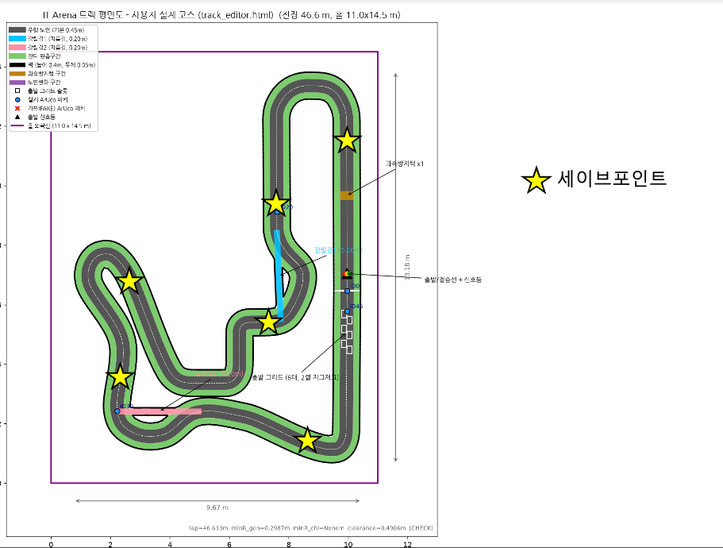

# ISTech IT Arena 대회 매뉴얼

> 기준: **2026-11-01 3차(최종) 회의** 반영본. 노션 회의록(2026-01-20 ~ 11-01)의 내용을 모두 옮겼으며, **이 문서가 대회 규칙의 정본**입니다.
> 규칙 관련 질문은 [이슈](../../issues)로 올려주세요. 답변이 공식 해석입니다.

## 1. 일정

- **대회일: 2026년 11월 14일 (토)**, 포항(POSTECH)
- 검차는 **대회 직전**에 진행 (§7 참고)

**당일 시간표** (2026-11-01 확정)

| 시간 | 경기 | 부스 |
|---|---|---|
| 11:00 – 12:00 | **동아리별 연습 주행** | 데모 |
| 12:30 – 13:00 | **프리랩** (그리드 · 베스트 랩타임 결정) | 데모 |
| 13:30 – 14:00 | **본 경기** | 데모 |
| ~ 18:00 | | 데모 |

## 2. 참여 동아리 · 운영진

참여(출전): Power-on(POSTECH), MR(KAIST), Pinocchio(UNIST), ROD(DGIST), ISAAC(GIST)
심판: MeKENic(KENTECH, 대회 출전 안 함)

당일 운영진 (동아리별 2명):

| 동아리 | 학교 | 담당자 | 운영진 (2명) |
|---|---|---|---|
| MR | KAIST | 안연수 | 김준홍, 류호현 |
| POWER-ON | POSTECH | 김민식 | 김민식, 김한준 |
| Pinocchio | UNIST | 김범준 | 우현민, 장오주 |
| R.O.D | DGIST | 정세현 | 황윤찬, 김승지 |
| ISAAC | GIST | 하준민 | 박서휘, 이진형 |
| MeKENic (심판) | KENTECH | 이재원 | 이재원, 김민석 |

총괄: 이윤혁 (POSTECH) · 회의록: 안연수 (KAIST, MR)

## 3. 지원 물품 · 예산

**공통 지원 물품** (9/10 이후 각 학교 담당자에게 배송):

- Jetson Orin Nano Super
- 배터리: [VEGA] 베가 그래핀 6셀 22.2V 2900mAh 70C
- 서보모터 ST3215-HS × 2
- PDB(전원분배보드) × 2 — 태진기술 협업 제작

**PDB 전류 특성** (모터 선정에 직결되는 정보):

- 피크 전류를 허용하는 구조입니다.
- **배터리 전압이 구동모터로 직결**됩니다.
- 따라서 **구동모터는 배터리의 방전 능력을 기준으로 선정**하세요.

📄 **데이터시트와 상세 사양: [docs/hardware/power-modules.md](docs/hardware/power-modules.md)**

주문·설계 전에 꼭 확인하세요.

- 지급되는 2장은 역할이 다릅니다 — **J01**(젯슨·MCU·센서) / **M01**(BLDC·서보 모터)
- **입출력이 전부 XT-30 암 커넥터입니다.** 케이블은 각 팀이 준비해야 합니다
- **보드 한 장이 10 × 14 cm**입니다. 두 장이면 차체 바닥(15 × 20 cm)의 약 93%라 적층을 고려하세요
- Preliminary 판이며, **07-15 요구사양과 다른 항목 3건을 제조사에 확인 중**입니다

### 예산 (2026-09-14 확정)

**학교별 지원 예산: 30만원**

예산 집계 방식은 다음과 같습니다.

1. **3만원 이상 물품의 합산**이 **30만원**을 넘을 수 없습니다.
2. 단, **모터와 센서류는 금액과 무관하게 무조건 합산에 포함**합니다.
3. 같은 품목이 여러 개 필요하면 **합산 금액**으로 계산합니다.
4. **합산에서 제외**: 필라멘트 · 볼트/너트 · 전선.
5. 제외 항목은 각 동아리가 자체 부담하되, **양심적으로 10만원 이내**로 합니다.
6. **결산안은 시합 전 반드시 제출**합니다. 각 동아리에서 준비해 오세요.

**예산 운용 (2026-10-06 추가)**

- **잘못 산 물품의 교체 구매** — 호환성 문제나 고장으로 쓸 수 없게 된 부품은, **해당 물품을 사용하지 않음을 증명**하고 같은 역할의 다른 제품을 동아리 자체 예산으로 구매해도 됩니다.
- **잔여 예산만큼의 신규 구매** — 제출한 예산안에서 금액이 남으면 그만큼 추가 구매가 가능합니다. **총액 30만원을 넘지 않는 것**이 조건입니다. **먼저 총괄에게 문의**해 지원금으로 구매가 되는지 확인하고, 불가하면 동아리 자체 예산으로 구매하세요.
- 어느 쪽이든 **최종 예산안에 반영해 제출**해야 합니다.

**결산안 (2026-10-06 확정 · 11-01 보완)**

| 항목 | 내용 |
|---|---|
| 기한 | **2026-11-13 (대회 전날)** |
| 제출처 | 로보틱스 디스코드 채널 |
| 내용 | **총괄에게 전달한 주문 목록 + 동아리에서 추가로 쓴 물품** (최종 차량에 들어간 부품 전체) + 비고 |
| **열람 제한** | **시합에 참가해 차량을 만드는 부원은 보지 못하게** 해 주세요 |

> 대표자끼리는 공유해 서로 견제하되, 제작 부원이 상대 차량 스펙을 보고 전략을 바꾸는 상황을 막기 위한 조치입니다. 대표자가 제작에 참여하는 팀은 **본인이 알되 다른 부원에게 전달하지 않는** 선으로 운영합니다.

### 지급 물품 반납 (2026-10-06 확정)

| 품목 | 반납 |
|---|---|
| **젯슨** | **무조건 반납** — 세트 전체 |
| 배터리 | 반납 대상. 단 **대회 당일 상태를 보고 반납이 어렵다고 판단되면 면제** |

**반납 방식 (2026-11-01 확정): 5팀 모두 11월 중 택배로 반납합니다.**

| 받는 곳 | 대전광역시 유성구 대학로 291 한국과학기술원, 지혜관 414호 |
|---|---|
| 수취인 | 안연수, 010-6351-6533 |
| 택배비 | **영수증과 통장 번호를 안연수에게 전달**하면 환급 |
| 팀별 | MR · Pinocchio · ISAAC · power-on · R.O.D — 전부 **11월 중 반납** |

**구매 방법**: 품명·단가·개수·링크·배송 주소를 엑셀로 정리해 총괄(이윤혁)에게 전달 (디스코드 업로드 후 멘션 또는 DM). 약 일주일 여유를 두고 주문합니다.
**주문 현황** (2026-11-01): **5팀 전원 주문 완료**

## 4. 트랙

트랙 전체 도면·시뮬레이터 파일은 [`track/`](track/) 폴더에 있습니다. **레이아웃·수치·사용법은 [track/README.md](track/README.md)가 기준**입니다.

- 재료·색: 도로 = **백색 포맥스**, 직선 벽 = **회색 포맥스**, 곡선 벽 = 라이트그레이 EVA폼, 트랙 외 = 초록 인조잔디 (2026-10-24 자재 주문 기준 · 시뮬도 같은 색, 자세한 값은 [track/README §6](track/README.md))
- 각 학교에 1×1m 폼 8장 지급 (바닥재 5 + 벽면 색 3) — 테스트베드용
- 노면변화: 트랙 외 부분은 잔디
- **과속방지턱: 없음** (2026-11-01 3차 회의에서 제거 확정 — 아래 참고)
- **출발 그리드 표시: 검정 테이프** (2026-11-01). 도로가 백색이라 흰 테이프는 보이지 않습니다.
- **피트인·피트스탑은 없습니다.** (확정 트랙에 피트레인 없음 — 2026-09-14 폐기 확정)

**코스 ArUco 마커 설치 방식** (2026-09-14 확정):

- 고속도로 표지판(갠트리)처럼 **마커가 길 가운데에 떠 있도록** 설치합니다.
- **벽 높이 40cm**로 두고, **벽 사이에 공간을 만들어** 그 자리에 마커를 답니다.
- **판 전체 10 × 10 cm**, 그 안의 **코드 영역은 7 × 7 cm** (흰 여백 사방 1.5 cm).
  마커의 **중심이 지면으로부터 40cm**에 오도록 설치합니다.
  - 직접 제작하실 때 "10 cm 코드"를 그리면 실제보다 40% 큰 마커가 됩니다. `aruco_print_sheet.pdf`를
    **100% 배율로 인쇄**하면 비율이 맞습니다.
  - **검출기 설정 주의** — OpenCV ArUco 기본값에서는 정상 마커가 누락됩니다.
    `minMarkerDistanceRate`를 **0.02**로 낮추세요. 자세한 내용과 측정 결과는
    [track/README.md §3.1](track/README.md)에 있습니다.

> 회의에서는 마커 크기를 5 × 5 cm로 정했으나, 이 안건(#12)이 원래 **검출 거리가 짧다**는 문제를 풀기 위한 것이라
> 크기를 절반으로 줄이면 갠트리식 설치의 이득이 상쇄됩니다. 설치 방식은 회의 결정 그대로 두고 **크기만 기존
> 10 × 10 cm를 유지**하도록 회의 후 조정했습니다. 이의는 9/21까지 받습니다.
>

**ArUco 0 · 45는 신호등 좌우에 붙입니다** (2026-11-01 확정)

- 출발선 근처의 0번·45번이 그리드에서 신호등을 **가리거나 신호등에 가려지지 않도록**, 두 마커를 **신호등 바의 좌우**로 옮깁니다.
- 접근 차량 기준 **왼쪽 = ID 45, 오른쪽 = ID 0**, 중심 높이는 다른 마커와 같은 40 cm입니다.
- 따라서 **0번과 45번은 같은 지점**(신호등 위치)에 있습니다. 랩·구간 판정에 두 마커를 따로 쓰셨다면 로직을 확인하세요.
- 시뮬은 [v2026.11.01](../../releases/tag/v2026.11.01)부터 반영돼 있습니다. 좌우 간격(중심 간 0.29 m)은 시뮬 추정값이고, 실물 부착 위치는 현장 기준입니다.

**준비 분담**

| 항목 | 담당 | 기한 | 상태 |
|---|---|---|---|
| ~~과속방지턱 3D 파일~~ | MR (운영진 제작) | — | **2026-11-01 제거 확정 — 사용하지 않음** |
| 신호등 | Pinocchio | 코드·CAD 즉시 / 조립은 부품 입고 후 | 코드·CAD·설치 사양 완료 ([#3](../../issues/3)) |
| 차량 크기 측정용 사각틀 | **power-on** | 대회 당일 | 내측 15 × 20 cm |
| 경기장 조명 조건 | power-on | — | ✅ 사진 공유 완료 |

**과속방지턱 — 제거 (2026-11-01 3차 회의)**

power-on이 고속 주행 중 방지턱 충격이 차체·모터 내구성과 주행 안정성에 주는 부담을 이유로 제외를 제안했고([#2](../../issues/2)), 3차 회의에서 **제거하기로 확정**했습니다.
실제 F1 트랙처럼 대회 트랙에는 방지턱이 없습니다. 시뮬([v2026.11.01](../../releases/tag/v2026.11.01))에서도 뺐습니다.

> 이미 출력해 두신 방지턱은 쓰지 않습니다. [`parts/speed_bump/`](parts/speed_bump/)는 기록용으로 남겨 둡니다.

**경기장 조명** — 사진과 개발 참고 사항을 **[docs/venue/](docs/venue/)**에 정리했습니다. 현장의 짐은 대회 때 모두 치워지며, **조명이 상당히 강합니다.** 전부 켜야 차량이 제대로 주행할 수 있다는 판단이므로 **전체 점등 기준으로 비전을 맞추세요.** 조명이 지향성이라 **밝기가 공간적으로 고르지 않으니 고정 노출은 피하세요.**

> lux 실측값은 **별도로 요청하지 않기로 했습니다.** 사진으로 충분하다고 판단했습니다.

## 5. 규칙 — 차량

- 사이즈: **15 × 20 cm**, **높이 40 cm 이하** (2026-10-06 명문화)
  - **측정 방법 (2026-11-01 확정)**: 현장에서 **내측이 15 × 20 cm인 사각틀**에 차량이 **통과하는지** 봅니다. 틀은 power-on이 준비합니다.
    틀은 차량의 **가장 바깥**에 걸리므로 **타이어 · 볼트 · 범퍼 · 마커 등 튀어나온 부분이 전부 포함**됩니다. CAD상 차체 폭이 아니라 실물 최외곽 기준으로 맞춰 주세요.
  - **초과 시 패널티 4단계** (베스트 랩타임의 50%)
  - 높이 제한은 9/14 회의에서 구두로 합의됐으나 문서에 누락돼 있었습니다. **신호등·벽 높이(40 cm)에 맞춘 값**입니다.
  - ⚠️ **실질 상한은 35 cm로 보세요.** 코스 ArUco 마커가 도로 정중앙 상공에 걸려 있고 **하단이 0.35 m**입니다.
    35 cm를 넘는 차량은 마커 구간에서 **좌우로 비켜 지나가야 하는데, 차폭 15 cm 기준 한쪽당 2.5 cm**밖에 여유가 없습니다.
    규칙상 40 cm까지 허용되지만 자율주행으로 그 틈을 통과하는 것은 현실적이지 않으니 **35 cm 이하 설계를 권합니다.**
    ([track/README.md](track/README.md) §3)
- 차량 식별 마커: 차량 뒷부분에 의무 부착, **5 × 5 cm** (마커 모양은 각 팀이 정해 공유)
  - 마커 미부착 시 출전 금지
  - 모양은 자유입니다. 다만 **ArUco를 쓰신다면** 아래를 지켜주세요. (2026-09-22 추가)
    - 코스 ArUco와 같은 **`DICT_4X4_50`을 쓸 경우 ID 0 · 20 · 30 · 45는 사용 금지** — 코스에
      설치된 ID라 차량과 표지판이 같은 파이프라인에서 섞입니다. ([track/README.md §3](track/README.md))
    - 사용하는 **사전 이름과 ID를 [이슈 #1](../../issues/1)에 명시** — 팀 간 중복은 먼저 올린 팀 기준으로 피합니다.
    - **현재 사용 중인 ID** (`DICT_4X4_50`): MR **1** · Pinocchio **7** · ROD **14** · ISAAC **49**
      power-on은 `DICT_7X7_100` **id 91**을 쓰고 있습니다. 사전 통일은 **권고일 뿐 필수가 아닙니다.**
    - 생성기: **[`tools/make_vehicle_marker.py`](tools/make_vehicle_marker.py)** — 예약 ID를 막고,
      만든 마커를 **기본 파라미터로 다시 검출해 검증**한 뒤 인쇄용 SVG까지 냅니다.
      직접 그리거나 이미지 생성 AI로 만든 마커는 디코딩되지 않습니다.

**원격 비상정지** (의무):

- **하드웨어 스위치와 소프트웨어 스위치를 각각 1개 이상** 마련합니다.
- 대회 당일 경기 전, **심판(MeKENic) 앞에서 작동을 시연**합니다.
- 작동하지 않거나 준비되지 않은 경우
  - 고의성이 있으면 → **패널티 3단계**
  - 고의성이 없으면 → 즉시 수정. 수정이 어려우면 최후의 방법으로 **젯슨 셧다운**도 가능. 그마저 어려우면 고의성이 있는 것으로 판단합니다.

## 6. 규칙 — 경기 진행

**자율주행 (2026-09-14 명문화)**

- 경기 중 차량 제어는 **전적으로 차량 자체 연산**에 의해야 합니다.
- 사람에게 허용되는 개입은 **리셋(정지·시작)까지만**입니다.
- 위반 시 **패널티 5단계 — 실격**.

**출발**

- 신호등을 차량이 **스스로 시각 인식**해 출발합니다. (UDP 등 무선 출발 신호 없음)
- 신호등은 **LED + 아두이노** 방식입니다. 왼쪽부터 **빨강 · 빨강 · 빨강 · 빨강 · 초록** 5세트(세트당 광원 2개)이고,
  빨강이 하나씩 켜진 뒤 **빨강이 모두 꺼지고 초록이 켜지는 순간이 출발**입니다. 3·4번째 빨강의 대기 시간이 매 경기 랜덤(1~3 s)입니다.
- **설치 위치 (Pinocchio, 2026-10-28)**: 선두 그리드 칸 앞선에서 **30 cm 앞**, 도로를 가로지르는 바에 매달림.
  발광부 중심 높이 **약 41.9 cm**(모듈 하단 39.7 cm), 발광면이 바닥과 **60°**를 이뤄 그리드 쪽을 내려다봅니다.
  카메라가 차량 최전면 · 높이 약 10 cm · 화각 60° 이상이라는 가정의 배치라 **카메라가 더 낮거나 화각이 좁으면 틸트를 조정**해야 할 수 있습니다.
- 시퀀스 · 코드 · CAD는 [이슈 #3](../../issues/3)과 시뮬 `traffic_light.py`에 있습니다.
- **신호 전 출발(부정출발) → 패널티 2단계.**

**경기 구성**

- 본 경기 **5랩**, 프리랩 **1랩**.
- 본 경기는 **전 차량 동시 투입**.
- **프리랩 순서는 랜덤**이며, 프리랩 결과로 **그리드(출발 순서)**를 정합니다.
- 코스 파트 구분은 ArUco 마커 기준.
- 차체 간 공격 금지.

**계측 · 판정**

- 랩타임 계측: **수동 스톱워치**. 계측은 **심판(MeKENic)과 각 동아리 운영위원**이 맡습니다.
- 순위 판정 기준: **차체 앞부분**.
- **베스트 랩타임** = 프리랩에서 나온 **가장 빠른 팀의 가장 빠른 랩타임**. 모든 패널티의 기준값입니다.

**경기 종료**

- 모든 차량이 완주 또는 리타이어하는 것을 기준으로 하되, **선두 완주 후 5분까지만** 기다립니다.
- **리타이어(DNF)는 순위 없이 리타이어 처리**합니다.

**사람 개입 · 정지 차량**

- **10초 이상 정지**한 차량에 한해 개입을 허용합니다.
- **사고 지점에서 재시작**하되, 접근이 어려우면 **세이브 포인트**에서 재시작합니다.

**세이브 포인트 (2026-11-01 확정)**

차량이 벽 등에 박혀 **도저히 움직이지 못할 때** 옮겨 두는 지점입니다. **코스에 7곳**, 각 위치의 **도로 가운데**입니다.

1. 먼저 해당 팀이 **원격으로 빠져나오기를 시도**합니다. 원격으로 할 수 있는 것은 **자율주행 시스템의 리셋(정지·시작)까지**이며, 키보드 등으로 직접 조종하는 것은 안 됩니다.
2. 그래도 안 되면 **심판에게 세이브 포인트 이동을 요청**합니다.
3. 심판이 **다른 차량에 방해가 되지 않는 순간**에 차량을 손으로 세이브 포인트로 옮기고, **바로 출발**시킵니다.

## 7. 패널티

**베스트 랩타임의 %를 전체 기록에 가산**하는 방식입니다. 판정은 심판(MeKENic)이 합니다.

| 단계 | 패널티 |
|---|---|
| 1 | 베스트 랩타임의 **5%** |
| 2 | 베스트 랩타임의 **15%** |
| 3 | 베스트 랩타임의 **30%** |
| 4 | 베스트 랩타임의 **50%** |
| 5 | **실격** |

**상황별 배정**

| 상황 | 단계 |
|---|---|
| 차체 공격 | 3 |
| 역주행 | 3 |
| 정체 (일시) | 2 |
| 정체 (주행 불능) | 1 |
| 잔디 진입 | 1 — **바퀴가 과반 초과로 나간 경우에만** |
| 트랙 훼손 | 4 |
| 지름길(갈림길) 실패 | 없음 |
| 부정출발 | 2 |
| 사이즈 초과 | 4 |
| 비상정지 미작동 (고의) | 3 |
| 원격 조종 등 자율주행 위반 | 5 (실격) |

> **정체(주행 불능)가 정체(일시)보다 가벼운 이유** — 주행 불능은 그 자체로 재시작 절차를 거쳐야 해서
> 시간 손실이 이미 큽니다. 그래서 가산 패널티는 더 낮게 두었습니다.

**잔디 진입 — 판정 기준 (2026-10-06 명확화)**

- **바퀴가 과반 초과로 나간 경우에만** 성립합니다. **2개까지는 나가도 패널티가 없습니다.**
- **밟는 순간 1회 발동**하며, 빠져나올 때까지 누적되지 않습니다.
- 다만 **장시간 잔디에서 주행**하면 심판 재량으로 별도 패널티가 부과될 수 있습니다.

> 추월을 목적으로 잔디로 나가는 선택지는 막지 않습니다. 다만 패널티 1단계(5%)가 **나갈 때마다 누적**되므로
> 트랙 안에서 추월하는 편이 대체로 유리합니다.

**프리랩 패널티 (2026-10-06 신설)**

프리랩은 단독 주행이라 적용될 수 있는 패널티가 **잔디 진입뿐**입니다. 다음과 같이 처리합니다.

1. **프리랩은 패널티 없이 그대로 주행**합니다. 그 기록으로 **그리드와 베스트 랩타임**을 정합니다.
2. 잔디 **이탈 횟수를 세어 두었다가**, **횟수 × 5%**(1단계)를 **본 경기 패널티로 적용**해 시작합니다.

> 프리랩 기록 자체에 패널티를 섞지 않기 때문에 **베스트 랩타임 기준이 왜곡되지 않습니다.**
> 잔디 이탈로 얻은 이득은 본 경기에서 그대로 회수됩니다.

**검차** — 대회 직전에 진행합니다. 심판(MeKENic)이 맡습니다.

- **사이즈 측정** — 내측 15 × 20 cm 사각틀 통과(§5) · 높이 40 cm
- **비상정지 시연** (심판 앞)
- **차량 식별 마커 부착 확인**
- **교차 검차 (2026-11-01 확정)** — 각 동아리 대표자가 현장에서 **다른 동아리의 차량을 확인**하고 문제되는 부분을 제기합니다.

결산안은 **전날인 11/13까지 디스코드로 제출**하고(§3), 검차 때 내용을 대조합니다.

**이의제기** — GitHub 이슈에 상시 등록해 주세요.

## 8. 리워드

후원사(로보틱어스)에서 제공해주어, 젯슨 나노 슈퍼 1개를 동아리에 리워드로 지급한다.

## 9. 2차 회의에서 종결된 이월 안건 (2026-10-06)

- **무선 채널 배정 — 안건 폐기.** 대회가 완전 자율주행이라 경기 중 원격 조종을 하지 않습니다. 채널을 나눌 실익이 없어 배정하지 않습니다.
  (원격 비상정지는 **의무 장비로 그대로 유지**됩니다. 폐기된 것은 채널 배정 절차입니다.)
- **LiPo 배터리 안전 수칙 — 별도 수칙을 두지 않습니다.** 지급 배터리가 전부 새 제품이라 부푼 셀이 나올 상황이 아니라고 판단했습니다. **대회장 내 충전을 허용**합니다.

## 10. 3차(최종) 회의 결정 (2026-11-01)

| 안건 | 결정 |
|---|---|
| 차량 크기 측정 | 내측 15 × 20 cm **사각틀 통과** 방식, 틀은 power-on 준비 (§5) |
| 과속방지턱 (power-on 제안, #2) | **제거** (§4) |
| 그리드 표시 | **검정 테이프** (§4) |
| ArUco 0 · 45 | **신호등 좌우에 부착** (§4) |
| 교차 검차 | 대표자가 다른 동아리 차량을 확인하고 문제 제기 (§7) |
| 세이브 포인트 | 7곳 지정, 심판이 이동 (§6) |
| 시간표 · 반납 · 결산안 · 계측 | §1 · §3 · §6 |

**이것으로 회의는 끝났습니다.** 이후 규칙 문의와 이의는 [GitHub 이슈](../../issues)로 올려주세요.

## 문서 이력

- 2026-11-02: **노션 회의록 이관** — 노션 16페이지와 대조해 운영진 명단(6팀)·반납 주소를 옮김. 이제 노션 없이 이 저장소만 보면 됩니다
- **2026-11-01: 3차(최종) 회의 반영** — 당일 시간표 · 크기 측정(사각틀) · 과속방지턱 제거 · 그리드 검정 테이프 ·
  ArUco 0·45 신호등 좌우 부착 · 신호등 설치 사양 · 세이브 포인트 · 교차 검차 · 계측 인원 · 반납(택배) · 결산안 범위.
  §6 신호등 설명을 실물 방식(빨강 4 → 초록 점등)으로 정정
- **2026-10-06: 2차 회의 반영** — 차량 높이 40cm 명문화 · 프리랩 패널티 신설 · 잔디 판정 명확화 ·
  예산 운용(교체·추가 구매) 및 결산안 기한(11/13) · 지급 물품 반납 규정 · 과속방지턱 담당 재배정(power-on) ·
  이월 2건(무선 채널 · LiPo) 종결
- 2026-08-30: 대표자 확정본
- 2026-08-31: 공개 저장소용 정리 (내부 운영 정보 제외, 트랙 수치는 track/README.md로 일원화)
- 2026-09-17: PDB 데이터시트 2종 게시 및 상세 사양 문서 연결 (docs/hardware/)
- 2026-09-15: ArUco 크기를 판 10cm / 코드 7cm로 구분 표기, 검출기 설정 주의 추가 (이슈 #12)
- 2026-09-14: 세부 규칙 확정 회의 반영 — 패널티 단계 개정(1·2단계 2%/5% → 5%/15%) 및 상황별 매핑, 예산 집계 방식, 자율주행 명문화, 비상정지 사양, 총 랩 수, ArUco 설치 방식, 신호등 방식, 순위 판정 기준, PDB 전류 특성, 피트 폐기 명시
