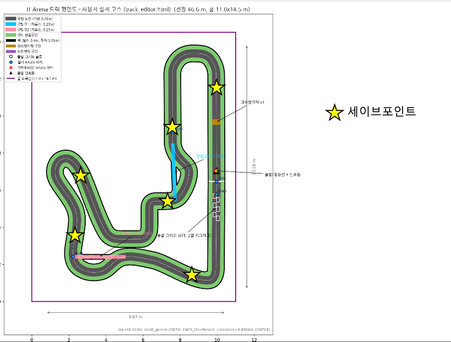

# 2026-11-01 미팅 — 3차(최종) 회의

| | |
|---|---|
| **일시** | 2026-11-01 (일) |
| **주관** | 이윤혁 (POSTECH, 총괄) |
| **기록** | 안연수 (KAIST, MR) |
| **직전 회의** | 2026-10-06 — 이월 2건 종결, 프리랩 페널티 신설, 차량 높이 40 cm 명문화 |
| **대회까지** | **D-13** (2026-11-14 토) |

> 마지막 회의입니다. 결정 사항은 [MANUAL.md](../MANUAL.md)에 반영했고, 이후 문의와 이의는 [GitHub 이슈](../../../issues)로 받습니다.

---

# ✅ 결정 요약

| # | 내용 | 반영 |
|---|---|---|
| 1 | **차량 크기 측정** — 내측 **15 × 20 cm 사각틀**을 power-on이 준비, 현장에서 차량이 **통과하는지** 확인 | MANUAL §5 · §7 |
| 2 | **과속방지턱 제거** (power-on 제안) | MANUAL §4 · 시뮬 v2026.11.01 |
| 3 | **그리드 라인은 검정 테이프**로 표시 | MANUAL §4 · 시뮬 v2026.11.01 |
| 4 | **ArUco 0 · 45를 신호등 좌우에 부착** — 신호등을 가리거나 신호등에 가려지는 마커를 없앰 | MANUAL §4 · 시뮬 v2026.11.01 |
| 5 | **교차 검차** — 동아리 대표자가 현장에서 다른 동아리 차량을 확인하고 문제를 제기 | MANUAL §7 |
| 6 | **세이브 포인트 7곳** 지정 · 이동 절차 확정 | MANUAL §6 |
| 7 | **당일 시간표** 확정 | MANUAL §1 |
| 8 | 랩타임 계측 = **MeKENic + 각 동아리 운영위원** | MANUAL §6 |
| 9 | 결산안 범위 = 총괄에게 전달한 목록 + 동아리 추가 구매분 | MANUAL §3 |
| 10 | 지급 물품 반납 = **5팀 모두 11월 중 택배** (KAIST로, 택배비 환급) | MANUAL §3 |

---

# 1. 차량 크기 측정 기준 (MR 질문)

**질문**: 매뉴얼에는 "직진 상태 CAD 폭 150 mm"만 적혀 있는데, 타이어·볼트처럼 튀어나온 부분도 포함되는가.

**결정**: 내측이 **15 × 20 cm인 사각틀**을 **power-on이 준비**하고, 현장에서 **차량이 틀을 통과하는지**로 판정한다.
틀은 차량의 가장 바깥에 걸리므로 **튀어나온 부분은 전부 포함**된다.

# 2. 과속방지턱 (power-on 제안, #2)

**제안**: 고속 주행 중 방지턱 충격이 주행 안정성과 내구성에 영향을 줄 수 있고, 속도감이 레이싱의 핵심이라 감속 구간이 재미를 더하지 않는다. 실제 F1처럼 제외하자.

**결정**: **제거**.

# 3. 그리드 라인 색

도로가 **백색 포맥스**로 확정되어(#16) 흰 테이프는 보이지 않는다. → **검정 테이프**로 표시.

# 4. 신호등과 ArUco 0 · 45

신호등 설치 사양(Pinocchio, #3): 선두 그리드 칸 앞선에서 **30 cm 앞**, 발광부 중심 **약 41.9 cm**(하단 39.7 cm), 바닥 대비 **60°**.

**결정**: 출발선 근처의 **ArUco 0번과 45번을 신호등 좌우에 부착**한다. 신호등을 가리거나 신호등에 가려지는 마커를 없애기 위함.

# 5. 교차 검차

동아리 대표자들은 현장에서 **본인 동아리가 아닌 다른 동아리의 차량을 확인**하고 문제되는 부분을 제기한다.

# 6. 당일 운영

| 항목 | 내용 | 담당 |
|---|---|---|
| 트랙 시공 | 시공 시점 · 인력 · 소요 시간 | (회의록에 기록 없음) |
| 검차 | 크기 측정(1번) · 비상정지 시연(심판 앞) · 식별 마커 부착 확인 | MeKENic |
| 랩타임 | 수동 스톱워치 | **MeKENic + 운영위원(각 동아리)** |
| 세이브 포인트 | 아래 참고 | 심판 |
| 결산안 | **11/13** 디스코드 제출 (대표자끼리만 공유). 총괄에게 전달한 목록 + 동아리에서 추가로 쓴 물품 | 각 팀 |
| 반납 | 젯슨 필수(세트) · 배터리 조건부 면제. **5팀 모두 11월 중 택배** | 각 팀 |

**세이브 포인트**

차량이 박아서 **결코 움직이지 못할 때** 이동하는 곳. 원격으로 조작해도 도저히 빠져나오지 못할 때 사람 손으로 옮긴다.
원격 조작은 **자율주행 시스템의 리셋까지만** 허용되며, 키보드 등으로 직접 조종하는 것은 불가능하다.

부딪힌 팀이 여러 방법을 시도한 뒤 **심판에게 세이브 포인트 이동을 요청**한다. 요청을 받으면 심판이 **다른 차량의 움직임에 방해가 되지 않는 순간**에 차량을 세이브 포인트(별 위치의 도로 가운데)로 옮기고 **바로 출발**시킨다.

> 위 그림의 바탕은 v2026.10.24 평면도라 방지턱 표시가 남아 있습니다. 방지턱은 이번 회의에서 제거됐습니다.

**반납 택배**

주소지: 대전광역시 유성구 대학로 291 한국과학기술원, 지혜관 414호 · 수취인: 안연수, 010-6351-6533. 택배비는 **영수증과 통장 번호를 안연수에게 전달**하면 환급합니다.

# 7. 당일 시간표

| 시간 | 경기 | 부스 |
|---|---|---|
| 11:00 – 12:00 | 동아리별 연습 | 데모 |
| 12:30 – 13:00 | 프리랩 | 데모 |
| 13:30 – 14:00 | 실제 경기 | 데모 |
| ~ 18:00 | | 데모 |

---

# 📦 후속 조치

| 내용 | 담당 | 상태 |
|---|---|---|
| 시뮬 반영 (방지턱 제거 · 그리드 검정 · 신호등 실물 위치 · ArUco 0·45 이동) | MR | [v2026.11.01](../../../releases/tag/v2026.11.01) |
| MANUAL 반영 | MR | 완료 |
| 15 × 20 cm 사각틀 준비 | power-on | 대회 당일 |
