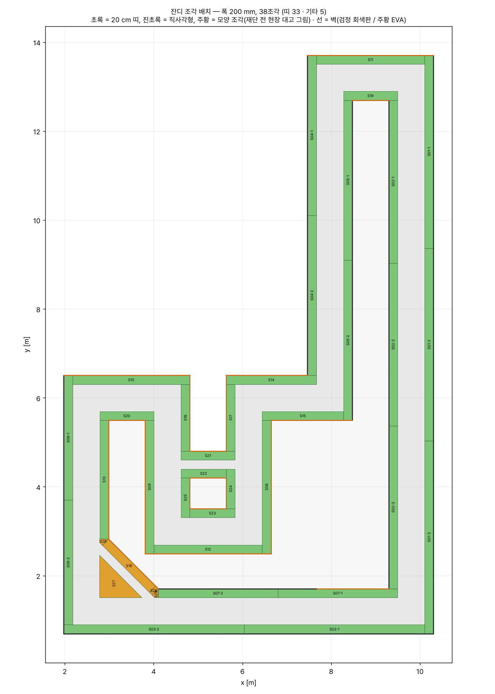
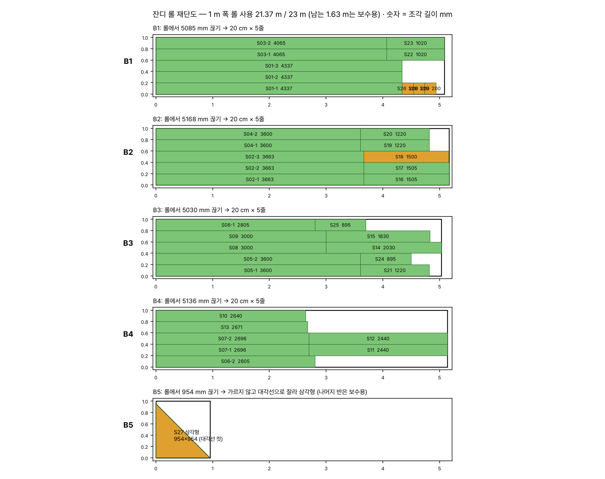

# 잔디 — 폭·재단·설치 (610mm 직각 코스)

도면: [`track/track_610mm_build_2026-11-05.pdf`](../../track/track_610mm_build_2026-11-05.pdf) · 생성기: [`make_grass_plan.py`](make_grass_plan.py)

## 폭: 도로 양옆 각 200 mm

본선 0.61 m와 지름길 0.20 m 모두 **양옆 200 mm**입니다. 근거는 세 가지입니다.

- PDF 26쪽의 완충 영역 외곽(x 1.975 ~ 10.305, y 0.695 ~ 13.705)이 도로 가장자리에서 정확히 200 mm 밖입니다.
- PDF 20~22쪽 벽 좌표선(W01~W61)이 전부 그 외곽선 위에 있습니다.
- 시뮬(`scene.json`의 `grass.width_each_side_m` = 0.2)도 같은 값입니다.

빈틈은 없습니다. 도로 판 가장자리부터 벽 면까지가 전부 잔디입니다.
P21 옆 작은 삼각형 섬은 벽 없이 **통째로 잔디**입니다(PDF 18쪽).

| 항목 | 값 |
|---|---|
| 잔디 면적 | **18.42 m²** (PDF 26쪽 약 18.38 m²와 일치) |
| 조각 | **38개** — 20 cm 띠 33개 · 모양 조각 5개 |
| 롤 사용 | 1 m 폭 롤 **21.37 m** / 23 m (남는 1.63 m는 보수용) |



## 재단 — 롤을 끊고, 20 cm씩 5줄로 가르기



1. **롤 폭을 먼저 잽니다.** 1,000 mm가 아니면 5번째 줄이 좁아집니다. 좁은 줄은 **벽 쪽**에 쓰면 됩니다.
   벽 아래 몇 mm 틈은 주행에 영향이 없습니다.
2. 롤을 **뒷면이 위로** 펼칩니다. [`grass_blocks.csv`](grass_blocks.csv)의 블록 길이(B1 5,085 mm 등)만큼 재고 폭 방향으로 끊습니다.
   직각자를 대고 자르세요.
3. 뒷면에 **200 · 400 · 600 · 800 mm** 선을 길게 긋습니다. 긴 금속자를 대고 커터로 **뒷면에서** 자릅니다.
   앞면에서 자르면 잔디 털이 같이 잘려 가장자리가 지저분해집니다. 날은 자주 갈아 주세요.
4. 한 줄 안에 조각이 여러 개면(예: `S03-1 + S22`) 재단도의 길이대로 끊습니다.
   **뒷면에 조각 번호를 적어** 블록별로 묶어 둡니다.
5. 모양 조각 5개는 현장에서 대고 마무리합니다. 모두 P21 사선 주변입니다.
   - `S18`: 1,500 mm 띠의 양 끝을 45°로
   - `S27`: 954 × 954 mm 직각삼각형. 블록 B5를 대각선으로 자릅니다
   - `S26` · `S28` · `S29`: 손바닥만 한 자투리

조각별 길이·위치·붙는 벽은 [`grass_pieces.csv`](grass_pieces.csv)에 있습니다.
긴 벽 쪽 띠는 B1~B4 블록 길이(약 5 m)에 맞춰 같은 길이로 나눴습니다(예: 13 m → 4,337 mm × 3).
이음은 **맞대기**입니다.

## 설치

순서는 PDF 13쪽과 같습니다. **도로 판 → 잔디 → 벽·받침**입니다.

1. 잔디를 **도로 판 가장자리에 맞대어** 깝니다. 도로 위로 올라오면 안 됩니다. 바깥 가장자리가 벽 좌표선입니다.
2. 양면테이프(다우 48 mm)를 **세로로 반 갈라 24 mm 두 줄**로 씁니다.
   - **도로 쪽 가장자리는 끊김 없이** 붙입니다. 차가 밟아 들뜨는 곳이 여기입니다.
   - 조각 이음마다 가로로 한 번 붙입니다.
   - 필요량은 약 96 m입니다. 60 m(6롤)를 반으로 가르면 120 m라 충분합니다.
3. 벽 쪽 가장자리는 테이프가 없어도 됩니다. 받침의 도로 쪽 턱(2.4 mm)과 벽 아래가 눌러 줍니다.
4. 도로(3T)보다 잔디(6 mm)가 3 mm 높습니다. 가장자리가 말려 올라오지 않는지 손으로 눌러 확인합니다.

> 홀 바닥이 광택 목재입니다. 테이프 자국이 남는지 **구석에서 한 번 시험**하고 붙이세요.

## 다시 만들기

```bash
python parts/grass/make_grass_plan.py        # 롤 길이 기본 23 m
python parts/grass/make_grass_plan.py 25     # 롤이 25 m라면
```

스크립트가 스스로 확인하는 것은 다섯 가지입니다. 하나라도 어긋나면 파일을 쓰지 않고 멈춥니다.

- 조각을 합치면 잔디 영역과 같은지
- 조각끼리 겹치지 않는지
- 잔디가 도로를 덮지 않는지
- 면적이 PDF 값과 맞는지
- 벽 61개가 모두 잔디 바깥선 위에 있는지
