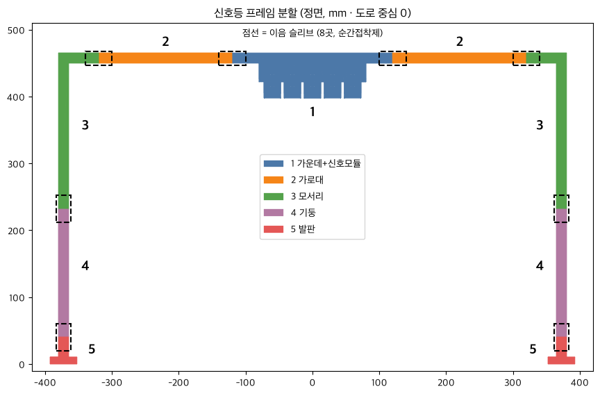

# 신호등 · ArUco 프레임 (610 mm 도로용)

`signal_610_old_style.stl` — **대회에서 쓰는 형상** (2026-11-13 확정).
Pinocchio의 10월 9일 원본(450 mm 도로용)에서 **가로 폭만 늘린 것**입니다. 가로대 +160 mm, 양쪽 기둥·발판을 각각 80 mm 바깥으로 옮겼습니다.
ISAAC이 수정했습니다. 신호등 코드(아두이노)는 그대로입니다.

| 항목 | 값 |
|---|---|
| 전체 | 폭 785 × 높이 465 × 깊이 57 mm |
| 기둥 | 15 × 15 mm, 도로 중심에서 365~380 mm (기둥 안쪽 사이 730 mm) |
| 발판 | 도로 중심에서 352~392 mm, 앞뒤 50 mm |
| 아래로 지나갈 수 있는 높이 | 397 mm (모듈 하단) |
| 발광부 | 모듈 폭 160 mm, 중심 높이 약 0.42 m, 60° 기울기 (시뮬과 같음) |

- **P1S(256 mm)에 한 번에 안 들어갑니다** → 아래 '나눠 뽑기'를 쓰세요.
- 같은 프레임을 **ArUco 20·30 마커 갠트리**로도 씁니다.

## 설치 위치 확인 (시뮬 좌표 기준)

도로 폭 610 mm면 발판은 도로 가장자리에서 47 mm 떨어진 잔디 위, 벽에서는 113 mm 안쪽에 놓입니다.

| 자리 | 결과 |
|---|---|
| 신호등 | 양쪽 발판 잔디 위 — OK |
| ID 30 | 양쪽 발판 잔디 위 — OK |
| **ID 20** | **지금 자리(s 17.55, 코너 안)면 한쪽 발판·기둥이 코너 뒤 도로 위에 놓입니다.** 진행 방향 뒤로(코너 들어가기 전으로) 0.32 m 옮기면 잔디 위로 빠집니다 → `id20_feet.png` |

ID 20 위치 확인은 ISAAC 제보입니다.

## 나눠 뽑기 (P1S · `print/`)

모양은 원본과 같고 자르기만 했습니다. 자른 면은 전부 15 × 14.6 mm 사각 봉이라 **사각 관(슬리브)을 씌우고 순간접착제로** 붙입니다.

| 판 | 내용 | 시간 | 설정 |
|---|---|---|---|
| `판1_가운데+발판_서포터켜기.3mf` | 1 가운데+신호모듈, 5 발판 ×2 | 약 4시간 30분 | **서포터 켜기**(tree auto), 브림 |
| `판2_나머지.3mf` | 3 모서리 ×2, 2 가로대 ×2, 4 기둥 ×2, 6 슬리브 ×8 | 약 5시간 | 브림 |

- 프린터 2대면 두 판 동시에 약 5시간입니다.
- 브림: Outer and inner, 5 mm. Bambu Studio에서 **Arrange(정렬) 누르지 마세요**. 왼쪽 앞 금지 구역을 피해 놓아 두었습니다.
- 슬리브 안쪽은 봉보다 0.4 mm 큽니다(15.4 × 15.0). 빡빡하면 사포, 헐거우면 접착제가 채웁니다.
- 조립: 기둥(4)을 발판(5) 위에 → 모서리(3) → 가로대(2) → 가운데(1). 이음마다 슬리브 하나.
- 낱개 STL도 `print/`에 있습니다(파일 이름 끝 숫자 = 뽑을 개수). 다시 만들기: `python parts/traffic_light/split_signal.py`
