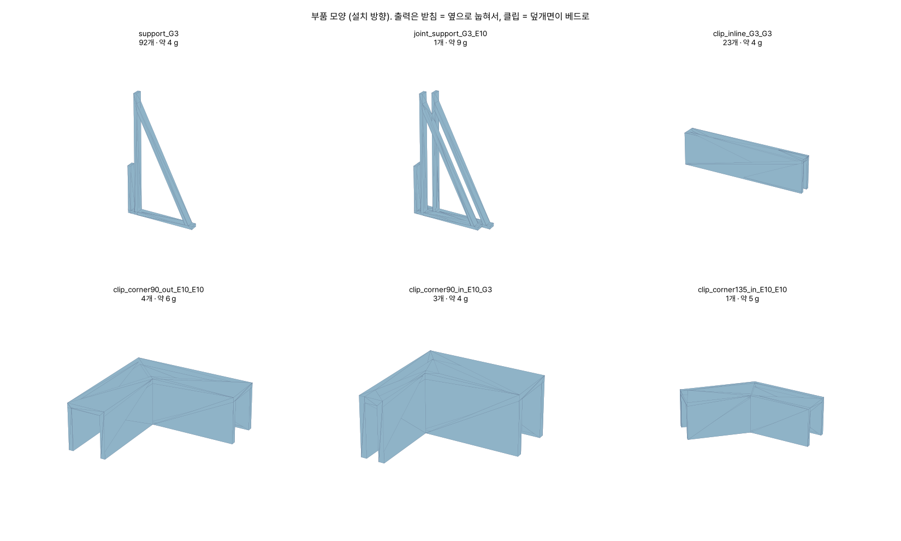
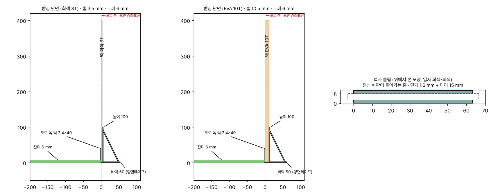
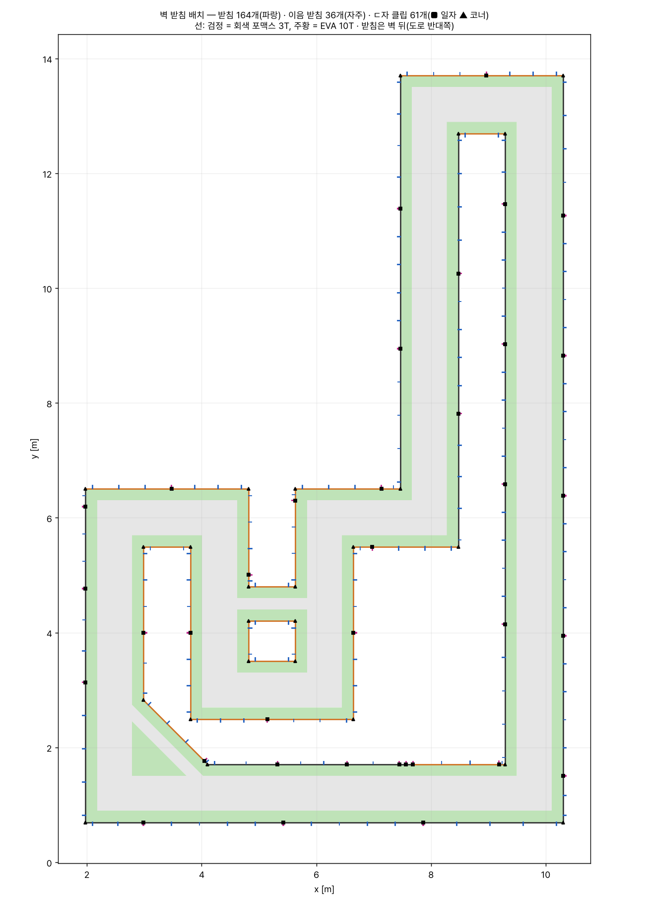

# 벽 받침 · ㄷ자 이음 클립 (610mm 직각 코스)

도면: [`track/track_610mm_build_2026-11-05.pdf`](../../track/track_610mm_build_2026-11-05.pdf) 18~22쪽 · 생성기: [`make_wall_parts.py`](make_wall_parts.py)

벽은 61조각입니다(W01~W61, 좌표는 [`walls_610.csv`](walls_610.csv)).

- 회색 포맥스 3T: 높이 406.7 mm (기존 G23·G24는 400 mm)
- EVA 10T: 높이 400 mm

도면의 선은 **벽의 도로 쪽 면**이고, 판은 선 바깥으로 두께만큼 나갑니다(PDF 18쪽).



## 부품 세 가지

| 부품 | 하는 일 | 수량 |
|---|---|---|
| **받침** `support_G3` / `support_E10` | 판 아래쪽을 홈에 꽂아 세웁니다. **벽 뒤**(도로 반대쪽)에 서고, 바닥판은 양면테이프로 붙입니다 | 92 + 72 |
| **이음 받침** `joint_support_*` | 판과 판이 맞닿는 곳 아래에 놓아 두 판을 한 받침에 같이 꽂습니다. 두께가 다르면(회색↔EVA) 홈이 계단입니다 | 36 |
| **ㄷ자 클립** `clip_*` | 판 윗변에 **위에서 끼우는** 덮개입니다. 일자 이음과 코너(90°·135°) 모두 있습니다 | 61 |



- **받침**: 높이 100 · 바닥 50 · 두께 6 mm, 부재 2.5 mm이고, 홈은 회색 3.5 / EVA 10.5 mm입니다.
  - 도로 쪽에는 2.4 × 40 mm 턱만 있습니다. 잔디 가장자리가 이 턱에 닿습니다.
  - **흰 도로 위에는 아무것도 올라가지 않습니다**(PDF 18쪽).
- **클립**: 살 1.6 mm, 다리 15 mm, 팔 30 mm입니다. 코너 클립은 모양이 여럿입니다.
  - `out`: 받침 쪽이 각의 바깥(외곽 벽 모서리)
  - `in`: 받침 쪽이 각의 안쪽(섬 모서리)
  - `_mirror`: 좌우가 반대인 모양입니다. 섞이지 않게 따로 담으세요.
- 판이 휘거나 넘어지는 것은 **첫 벽 한 구간을 세워 보고** 판단합니다(PDF 18쪽).
  치수는 `make_wall_parts.py` 맨 위 숫자만 고치면 전부 다시 나옵니다.

## 배치



- **받침 간격은 600 mm 이하**(PDF 18쪽)이고, 코너에서는 120 mm 안쪽에 첫 받침을 둡니다.
- 300 mm보다 짧은 판(W29·W30·W32·W50·W52·W54)은 받침을 따로 두지 않고 양 끝 이음 받침이 잡습니다. 한쪽 끝이 코너면 가운데에 받침 1개를 둡니다.
- 현장에서는 [`supports.csv`](supports.csv)를 보고 놓습니다. **벽 번호와 그 벽 시작점(PDF W표의 앞 좌표)에서 mm**로 적혀 있습니다.
- 생성기가 확인하는 것:
  - 받침이 도로를 침범하지 않는지
  - 잔디는 턱만 닿는지
  - 받침끼리 겹치지 않는지
  - 홀 안에 있는지
  - 판마다 간격이 600 mm 이하인지

## 출력 (Bambu P1S)

| 항목 | 값 |
|---|---|
| 설정 | 0.4 노즐 · 0.20 mm Standard · Bambu PLA Basic(회색) · **서포트 없음** |
| 방향 | 받침·이음 받침은 **옆으로 눕혀서**(단면이 베드에), 클립은 **덮개면이 베드에**. STL이 이미 그 방향입니다 |
| 수량 | [`parts_count.csv`](parts_count.csv) |

Bambu Studio 슬라이스 값입니다(0.20 Standard, 1개씩).

| 부품 | 1개 | 수량 | 합계 |
|---|---|---|---|
| 받침 | 8분 · 4.2 g | 164 | 22.8시간 · 0.69 kg |
| 이음 받침 | 15분 · 8.0 g | 36 | 8.8시간 · 0.29 kg |
| ㄷ자 클립 | 9~11분 · 4.4~6.1 g | 61 | 9.9시간 · 0.29 kg |
| **합계** | | 261 | **약 41시간 · 1.3 kg** (예비 10 % 넣으면 약 46시간) |

### 11-07 개선: 95시간 → 41시간

처음 설계(높이 150 · 바닥 70 · 두께 10 · 부재 4 mm)는 받침 1개가 21분, 전체가 약 95시간·4.0 kg이었습니다.
출력 시간은 거의 **필라멘트 양에 비례**합니다. 그래서 형태는 그대로 두고 살을 줄였습니다.

| 바꾼 것 | 이유 |
|---|---|
| 높이 150 → **100** | 벽 윗부분은 ㄷ자 클립이 옆 판과 묶어 줍니다. 첫 벽 시험에서 위쪽이 흔들리면 `H`를 올리세요(10 mm당 약 0.5분) |
| 부재 4 → **2.5 mm** | 0.42 mm 선 6줄로 꽉 차서 채움(infill)이 없습니다 |
| 두께 10 → **6 mm** | 빗대 좌굴 하중은 약 26 N입니다(오일러, PLA E = 3.5 GPa). 600 mm마다 하나씩이라 차가 한 곳을 밀어도 여러 개가 나눠 받습니다 |
| 클립 살 2 → 1.6 · 다리 20 → 15 · 팔 40 → 30 mm | 클립 15분 → 9분 |

시험해 본 다른 방법도 남겨 둡니다.
- **클립을 옆으로 눕혀 출력**: 차이가 없었습니다(8.4분).
- **받침 간격 800 mm**: 받침이 39개 줄어 약 5시간 빠집니다. 첫 벽 시험에서 600 mm가 넉넉하면 `SPACING`을 바꾸세요.
- **클립 대신 청테이프**: 클립 61개를 빼면 약 10시간이 빠집니다. 예산안의 청테이프 50롤이 벽 이음용입니다.
  코너는 두 판이 서로 받쳐 주므로, 코너 클립(25개, 약 4시간)만 테이프로 바꾸는 것도 방법입니다.

> 한 판에 여러 개를 올려도 1개당 시간은 거의 같습니다(받침 16개 = 4판 × 32.7분).
> 판을 갈아 끼우는 횟수를 줄이려면 Bambu Studio에서 손으로 촘촘히 배치하세요. 받침이 56 × 100 mm라 한 판에 8개 이상 들어갑니다.

## 다시 만들기

```bash
pip install numpy shapely manifold3d trimesh matplotlib
python parts/wall_support/make_wall_parts.py
```

STL은 전부 닫힌 입체(watertight)인지 확인한 뒤에만 저장합니다.
